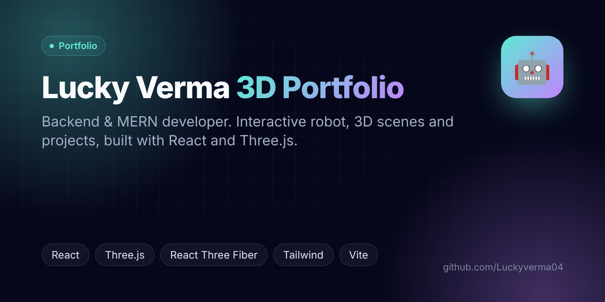
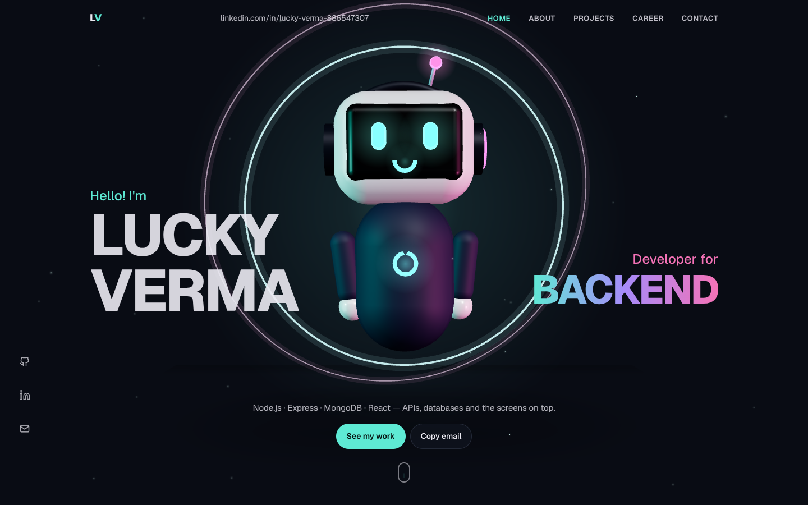
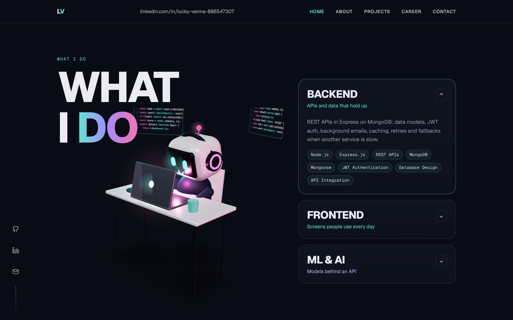
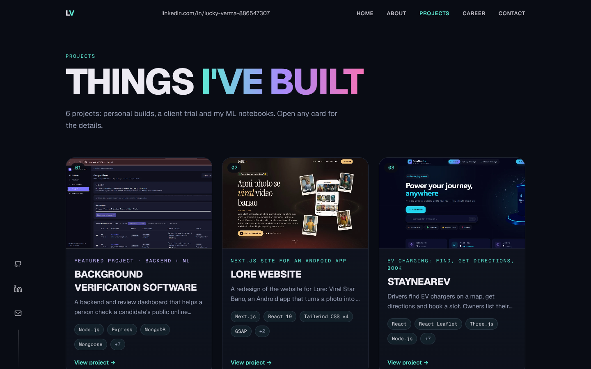
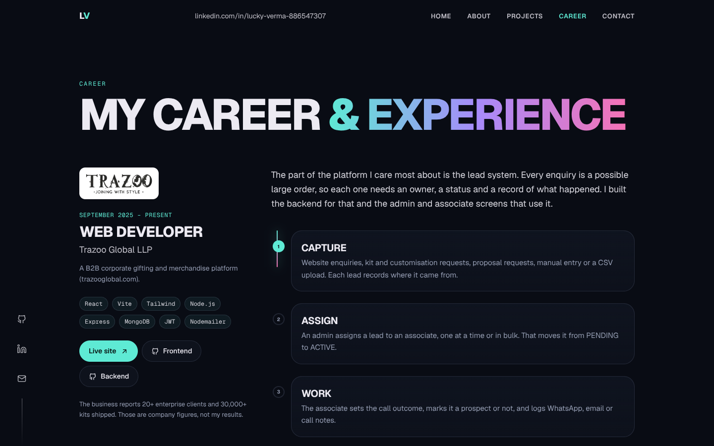
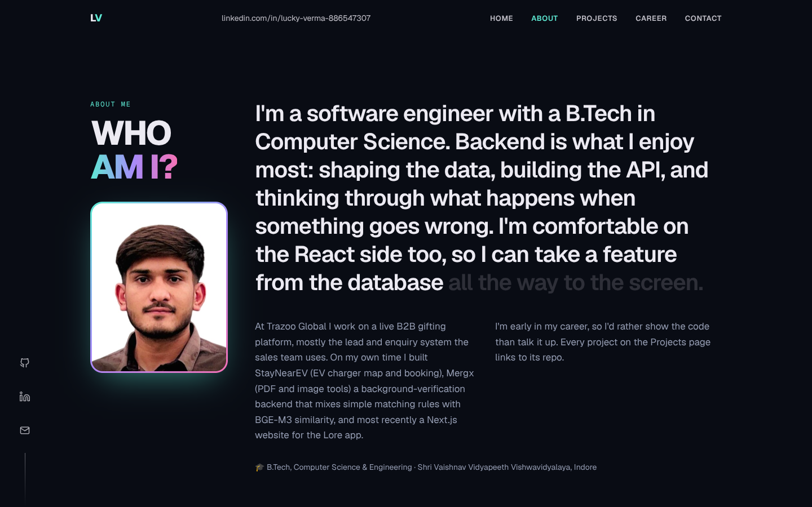
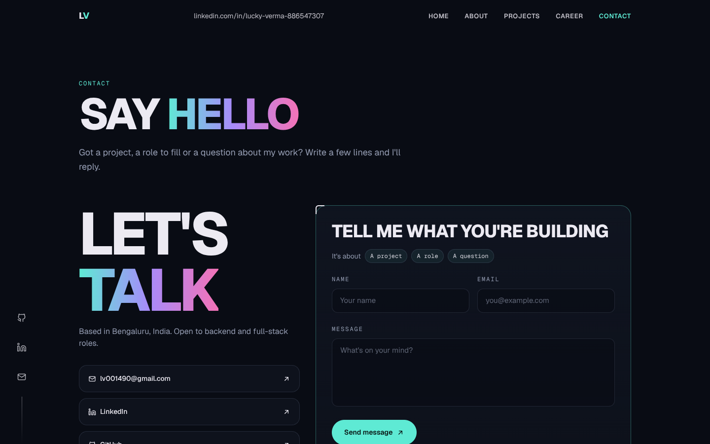

<div align="center">



# 🤖 Lucky Verma — 3D Portfolio

**Backend & MERN developer portfolio** with an interactive 3D robot, 3D scenes and project galleries.

[🌐 Live site](https://lucky-portfolio-tau.vercel.app) · [💼 LinkedIn](https://www.linkedin.com/in/lucky-verma-886547307/) · [🐙 GitHub](https://github.com/Luckyverma04)


</div>

---

## 📸 Screenshots

| Home | What I do |
|---|---|
|  |  |

| Projects | Career & experience |
|---|---|
|  |  |

| About | Contact |
|---|---|
|  |  |

## ✨ Highlights

- Animated 3D robot hero and desk scene built from basic shapes in code (React Three Fiber), no downloaded models
- Sections: Hero, What I do, Projects with screenshot slideshows, Career (Trazoo), Tech stack, About, Contact
- Contact form through EmailJS, with a fallback when keys are missing
- All text lives in one file (`src/data/content.js`); screenshots are picked up from folders automatically

## 🛠️ Tech stack

React 18 · Vite · Tailwind CSS · Three.js · React Three Fiber · Drei · React Router · EmailJS

---

Live: https://lucky-portfolio-tau.vercel.app

## Run locally

```bash
npm install
npm run dev        # http://localhost:5173
npm run build      # production build in dist/
npm run preview
```

## Add images (no code changes needed)

**Project screenshots** go in `src/assets/gallery/<project>/`:

| Folder | Shows up in |
|---|---|
| `background-verification/` | 01 Background Verification Software |
| `lore/` | 02 LORE Website |
| `staynearev/` | 03 StayNearEV |
| `mergx/` | 04 Mergx |
| `react-projects/` | 05 React Projects Collection |
| `ml-journey/` | 06 ML Journey |
| `trazoo/` | Career section (Trazoo) |

- Images show in filename order, so name them `01-home.webp`, `02-dashboard.webp`, ...
- `.webp`, `.jpg` or `.png` all work. About 1400–1600px wide and under ~300 KB keeps the page fast.
- The first two images of a project stay on screen; any more play as a slideshow under them.

**Your photo:** save it as `public/profile.jpg` (4:5, about 800x1000). It appears in the About section.

## Edit text

All content (projects, job, skills, links) lives in `src/data/content.js`.

## Project structure

```
src/
  components/   Page sections (Hero, About, WhatIDo, Experience, Projects, TechStack, Contact...)
  three/        3D scenes: Bot (robot), HeroScene, DeskScene, TechBalls, LazyCanvas
  data/         content.js (all text), gallery.js (loads screenshots)
  assets/       gallery/ screenshots, tech/ logos, trazoo-logo.png
public/         favicon, og.png, robots.txt, sitemap.xml
```

## Contact form (EmailJS)

Copy `.env.example` to `.env` and fill in the three `VITE_APP_EMAILJS_*` values. Add the same variables on your host (Vercel or Render). Without them the form tells visitors to email directly.

## Credits

3D scenes are built from basic shapes in code; no downloaded models.

---

## 🖼️ Image links

| Image | Link |
|---|---|
| Banner | https://raw.githubusercontent.com/Luckyverma04/Lucky-Portfolio/main/docs/banner.png |
| Home – 3D robot hero | https://raw.githubusercontent.com/Luckyverma04/Lucky-Portfolio/main/docs/screenshots/home.png |
| What I do | https://raw.githubusercontent.com/Luckyverma04/Lucky-Portfolio/main/docs/screenshots/what-i-do.png |
| Projects | https://raw.githubusercontent.com/Luckyverma04/Lucky-Portfolio/main/docs/screenshots/projects.png |
| Career & experience | https://raw.githubusercontent.com/Luckyverma04/Lucky-Portfolio/main/docs/screenshots/experience.png |
| About | https://raw.githubusercontent.com/Luckyverma04/Lucky-Portfolio/main/docs/screenshots/about.png |
| Contact | https://raw.githubusercontent.com/Luckyverma04/Lucky-Portfolio/main/docs/screenshots/contact.png |

<div align="center">

Made with ⚡ by **[Lucky Verma](https://github.com/Luckyverma04)**

</div>
